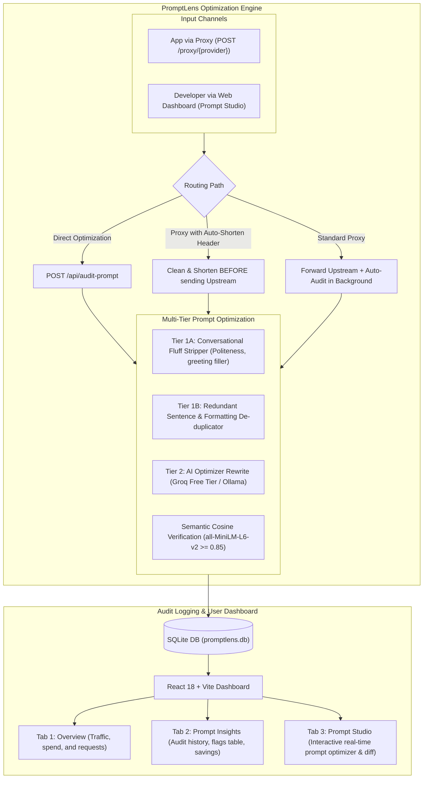
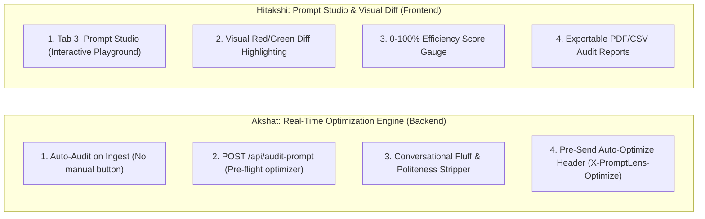

# PromptLens: Project Advisory & Team Execution Guide
## Core Mission: Real-Time Prompt Efficiency & Intelligent Prompt Optimizer

> **Audience:** Core Project Team (Akshat, Hitakshi)  
> **Project Title:** PromptLens — The Real-Time LLM Prompt Auditor & Optimizer Studio  
> **Repository Root:** `C:\Users\aksha\OneDrive\Desktop\PromptLens`  
> **Cost Guarantee:** **$0.00 Required** (Fully operational on Groq Free Tier, Ollama, and local CPU heuristics).

---

## 1. Project Overview & Updated Core Workflow

PromptLens is not just an API traffic logger; **its primary USP is making AI prompts lean, efficient, and cost-effective**. It audits incoming prompts for waste, removes bloat, calculates exact token savings, and provides an interactive "Prompt Studio" where developers can test and optimize prompts before sending them to AI models.

### End-to-End System Architecture



---

## 2. Cost & Free AI Strategy ($0.00 Out-of-Pocket)

The team does **not** need a paid AI account to build, test, and demonstrate this project:
1. **Local Heuristics (0 cost)**:
   - Duplicate sentences, repeated whitespace, and conversational filler stripping run as fast pure-Python regex and string algorithms on your CPU.
2. **Local Semantic Verification (0 cost)**:
   - Sentence embedding comparisons (`all-MiniLM-L6-v2`) run locally via `sentence-transformers` on your CPU.
3. **LLM Prompt Rewriter (0 cost)**:
   - Configured with **Groq Cloud's Free Tier** (active fast model: `openai/gpt-oss-20b` or `llama-3.3-70b-versatile`). Groq gives free developer API keys with fast token speeds and no credit card required.
   - Alternatively, it can run 100% offline using **Ollama** (`ollama run llama3`).

---

## 3. What Is Completed & Working (Phases 1 – 6)

1. **Proxy & Adapter Engine**: Reverse proxy for OpenAI, Anthropic, Gemini, Groq, and Ollama with async logging and cost accounting.
2. **Read & Analytics API**: SQLite WAL database with time-bucketed aggregation, zero-gap filling, and pagination.
3. **Overview Dashboard**: React 18 single-page app with date range filters, Recharts charts, and request inspection drawers.
4. **Prompt Analyzer**: Batch detector for `redundant_sentences`, `repeated_content`, and `verbose_for_template`.
5. **Suggestion Engine**: Deterministic cleanups and LLM rewrites with cosine similarity checks and tool overhead tracking.
6. **Prompt Insights UI**: Two-tab navigation, summary audit cards, "Run analysis" action, flags table, side-by-side prompt diff, and clipboard copy.

---

## 4. How to Run Frontend & Backend

### Terminal 1: Backend
```powershell
cd "C:\Users\aksha\OneDrive\Desktop\PromptLens"
.\venv\Scripts\activate
uvicorn app.main:app --reload --port 8000
```
* **Interactive Docs**: [http://localhost:8000/docs](http://localhost:8000/docs)
* **Backend Stats**: [http://localhost:8000/api/stats/summary](http://localhost:8000/api/stats/summary)

### Terminal 2: Frontend
```powershell
cd "C:\Users\aksha\OneDrive\Desktop\PromptLens\frontend"
npm install
npm run dev
```
* **Dashboard**: [http://localhost:5173](http://localhost:5173)

### Unit Tests & Verification
```powershell
cd "C:\Users\aksha\OneDrive\Desktop\PromptLens"
.\venv\Scripts\pytest.exe -v -m "not slow"
```

---

## 5. Work Division: Real-Time Prompt Efficiency

To transform PromptLens from an offline batch auditor into a real-time prompt efficiency suite, the remaining work is divided into two distinct tracks:



### Responsibility Breakdown

| Member | Domain & Ownership | Key Files Owned |
| :--- | :--- | :--- |
| **Akshat** | **Backend Optimization & Interception**<br>• Auto-audit on ingest inside proxy `BackgroundTasks`<br>• Real-time `POST /api/audit-prompt` endpoint<br>• Conversational filler & politeness stripping heuristic<br>• Optional live prompt shortening prior to upstream dispatch (`X-PromptLens-Optimize: true`) | `app/proxy.py`<br>`app/fluff_cleaner.py`<br>`app/api.py`<br>`tests/test_audit_prompt.py` |
| **Hitakshi** | **Frontend Studio & UX Intelligence**<br>• New 3rd Tab: "Prompt Studio" (paste any prompt, click Optimize)<br>• Word-level visual diff viewer (red strikethrough for removed text)<br>• Efficiency Score badge (0–100%) with actionable tips<br>• PDF & CSV export for project presentations | `frontend/src/components/PromptStudio.jsx`<br>`frontend/src/components/DiffViewer.jsx`<br>`frontend/src/components/ExportModal.jsx`<br>`frontend/src/App.jsx`<br>`frontend/src/App.css` |

---

## 6. Antigravity Prompt for Akshat (Backend Track)

Copy and paste this entire prompt into Antigravity:

````markdown
You are an expert Python/FastAPI engineer working on PromptLens (C:\Users\aksha\OneDrive\Desktop\PromptLens).
Python virtual environment: C:\Users\aksha\OneDrive\Desktop\PromptLens\venv\Scripts\python.exe

### Project Goal:
PromptLens's primary mission is making LLM prompts efficient and optimizing them in real time. We are transforming it from an offline batch tool into a real-time prompt efficiency engine.

### Your Assignment (Akshat's Track):
Implement the following four backend capabilities cleanly without breaking existing tests:

1. **Auto-Audit on Every Request (Instant Background Ingest)**:
   - In `app/proxy.py`, whenever a request is logged, immediately enqueue a background task to analyze that individual request (run the single-prompt analysis from `app/analyzer.py` and auto-generate the suggestion if flags are detected).
   - The user should never have to manually click "Run analysis" for new requests.

2. **Pre-Flight Prompt Optimizer Endpoint (`POST /api/audit-prompt`)**:
   - Create a fast standalone endpoint in `app/api.py`: `POST /api/audit-prompt`.
   - Accepts JSON payload: `{"prompt_text": "...", "provider": "groq", "model": "openai/gpt-oss-20b"}`.
   - Runs:
     1. Conversational fluff removal.
     2. Exact duplicate sentence removal.
     3. Repeated content formatting cleanup.
     4. (Optional) Tier 2 LLM rewrite if template is verbose and `ENABLE_LLM_REWRITE=true`.
   - Returns JSON:
     ```json
     {
       "original_prompt": "...",
       "optimized_prompt": "...",
       "tokens_original": 120,
       "tokens_optimized": 78,
       "tokens_saved": 42,
       "efficiency_score": 65,
       "flaws_detected": ["conversational_fluff", "redundant_sentences"],
       "explanations": ["Removed polite conversational preamble.", "Removed 1 duplicate sentence."]
     }
     ```

3. **Conversational Fluff & Politeness Stripper (`app/fluff_cleaner.py`)**:
   - Detects and removes polite conversational filler that wastes tokens in everyday AI prompts:
     - Greetings/Preamble: *"Hey ChatGPT", "Hello AI", "Good morning", "I hope you are having a great day"*
     - Polite filler: *"Could you please kindly help me with...", "I was wondering if you could possibly...", "Please act as an expert and..."*
     - Trailing pleasantries: *"Thank you so much in advance!", "Thanks!"*
   - Returns the cleaned text and the number of characters/tokens saved.

4. **Live Auto-Optimize Proxy Mode**:
   - In `app/proxy.py`, check for the header `X-PromptLens-Optimize: true` (or query param `?optimize=true`).
   - If present, clean the prompt using the fluff and duplicate cleaner *before* dispatching it to the upstream LLM, immediately saving tokens live on the wire.

### Verification:
- Write unit tests in `tests/test_audit_prompt.py` testing the new endpoint and fluff cleaner.
- Run `.\venv\Scripts\pytest.exe -v -m "not slow"` to ensure all tests pass.
````

---

## 7. Antigravity Prompt for Hitakshi (Frontend Track)

Copy and paste this entire prompt into Antigravity:

````markdown
You are an expert React engineer working on PromptLens (C:\Users\aksha\OneDrive\Desktop\PromptLens\frontend).
Backend API: http://localhost:8000

### Project Goal:
PromptLens's primary mission is making LLM prompts efficient. We are creating an interactive "Prompt Studio / Doctor" where users can test, audit, and optimize prompts in real time.

### Your Assignment (Hitakshi's Track):
Implement the following four UX capabilities in plain React 18, Vite, and plain CSS without third-party component libraries:

1. **New 3rd Tab: "Prompt Studio" (`src/components/PromptStudio.jsx`)**:
   - In `src/App.jsx`, add a 3rd navigation tab: `Overview`, `Prompt Insights`, and `Prompt Studio`.
   - The Prompt Studio features:
     - A large multi-line textarea for users to paste any raw prompt.
     - An "Optimize Prompt" action button that calls `POST /api/audit-prompt`.
     - Loading state with spinner.
     - When optimized, displays:
       - **Efficiency Score** circular badge (e.g. `92% - Highly Efficient` in green, or `54% - High Waste` in red).
       - Quick stats: *Original Tokens*, *Optimized Tokens*, *Tokens Saved (% saved)*.
       - Explanations list of what was cleaned (e.g., *"Removed conversational fluff"*, *"Removed duplicate sentence"*).

2. **Visual Red/Green Diff Viewer (`src/components/DiffViewer.jsx`)**:
   - Inside Prompt Studio and in the existing `SuggestionView.jsx`, add a visual diff mode.
   - Highlights deleted filler/redundant words in soft red with strikethrough (`<del>` / `.diff-deleted`).
   - Displays preserved/clean text normally.
   - Includes a one-click "Copy Optimized Prompt" button with feedback (`✓ Copied!`).

3. **Audit Report Exporter (CSV & PDF)**:
   - In the header of `src/components/InsightsTab.jsx`, add an "Export Report" button.
   - Exports all flagged prompts and savings to a downloadable CSV.
   - Provides a print stylesheet (`@media print`) so using the browser's Print to PDF produces a clean, professional executive report suitable for major project viva presentations.

### Constraints:
- Use plain React 18, plain CSS in `src/App.css`, and Recharts. Do not install Tailwind, Material-UI, or Bootstrap.
- Maintain existing tab state preservation in `App.jsx`.
- Run `npm run build` inside `frontend/` to ensure zero compilation or styling errors.
````

---

## 8. Delivery Checklist for Final Submission

- [x] Real-time auto-audit works on every proxy request without manual button clicks.
- [x] `POST /api/audit-prompt` returns instant prompt optimizations.
- [x] Conversational fluff cleaner strips filler and politeness bloat.
- [x] Prompt Studio tab lets users interactively optimize any prompt in the browser.
- [x] Visual diff highlights removed words with red strikethrough.
- [x] Backend tests pass: `pytest -v -m "not slow"`.
- [x] Frontend builds cleanly: `npm run build`.
- [x] System operates with $0.00 cost using Groq free tier / Ollama.
